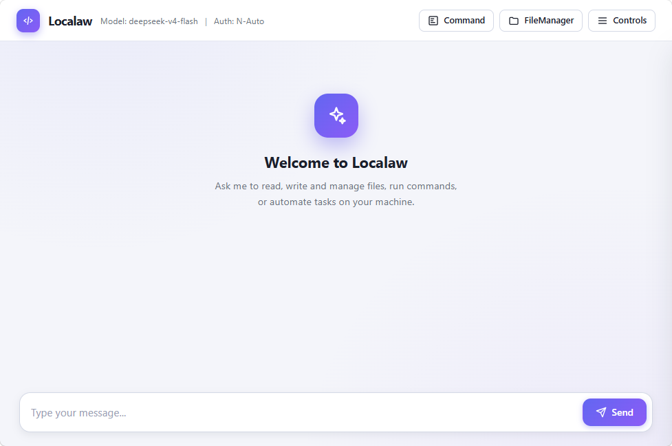
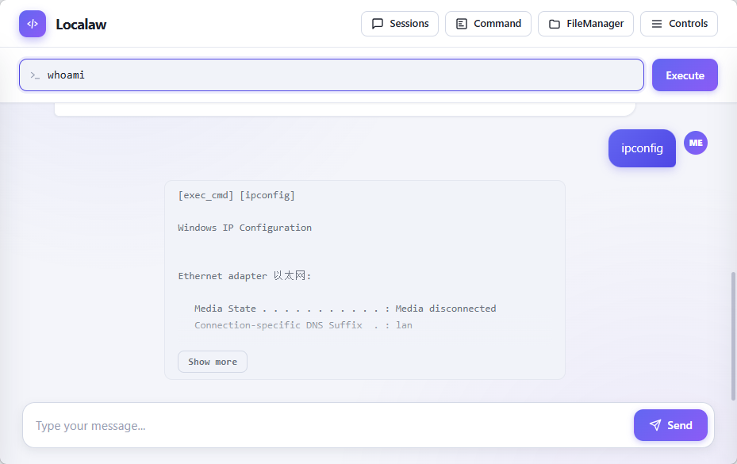
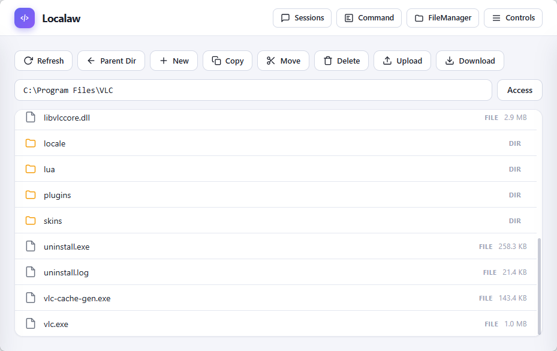

# Localaw

**中文** | [English](#english)

一个由 Go 编写的**纯本地 AI Agent**：连接 OpenAI 兼容的大模型 API（原生 Tool/Function Calling），
把模型的意图作为标准工具调用在**本机**执行，并把结果回灌模型续轮。

> 本项目是对原 Python 版 Localaw 的 Go 重构：指令调用从「提示词 → JSON 解析 → 执行」重写为
> **标准 Tool Calling** 流程；新增**多会话**；CLI 与 Web 交互参考 C2Agent 设计，界面基于原 Localaw 前端。



---

## 1. 特性

- **原生工具调用**：使用官方库 `github.com/openai/openai-go`，兼容任意 OpenAI 兼容端点（Ollama / vLLM / DeepSeek / OpenAI）。
- **多会话**：可同时存在多个彼此独立的会话（各自历史、轮数、授权、停止），会话在后台运行，页面刷新/断线不中断。
- **线性指令队列**：所有动作（LLM 工具调用与操作员直连命令）经**单条 FIFO 队列**串行执行；
  **排队等待不超时，执行中受 `cmd_timeout` 限制**，超时终止**整个进程树**。
- **三级授权**：`0` N-Auto（全部需授权）、`1` H-Auto（低风险自动）、`2` F-Auto（全部自动）；
  授权通过会重置本轮轮数预算；拒绝则**不下发**该动作并结束本轮。
- **超时即失败**：执行超时终止进程树并将错误回灌模型（无断连语义，因为是本地执行）。
- **CLI + Web**：CLI 交互；Web 面板含会话列表、流式对话、授权弹窗、文件管理器、命令面板、授权模式滑块、深浅主题。
- **纯 Go、无 CGO**：可交叉编译 Windows / Linux / macOS 单文件二进制；前端以 `go:embed` 内嵌。

---

## 2. 架构

```
                    Localaw（Go 单进程）
  ┌──────────────────────────────────────────────────────────┐
  │   CLI              Web（net/http + SSE + go:embed 单页）   │
  │        └──────────────────┬───────────────────┘          │
  │                     Engine（多会话 / 授权 / 轮数 / 事件广播）│
  │                           │                              │
  │                    线性指令队列（单条 FIFO dispatcher）     │
  │                           │                              │
  │                    Executor（本机执行）                    │
  │        ┌──────────────────┴──────────────────┐           │
  │   FileModule（文件操作）                 exec_cmd（Shell）  │
  └──────────────────────────────────────────────────────────┘
                           │
                   本机文件系统 / Shell
```

**一次工具调用的数据流**：用户消息 → 该会话 goroutine → LLM（带 tools）→ 返回 `tool_calls`
→ 安全检查 → 授权判定 → 封装 Job 入队列（排队不超时）→ dispatcher 执行（受 `cmd_timeout`）
→ 结果写回本会话（`role=tool`）→ 回灌续轮（受 `round_limit`）。

---

## 3. 目录结构

```
LocalawX/
├── go.mod / go.sum
├── config.example.json
├── README.md / design.md
├── cmd/localaw/main.go            # 入口：--mode cli|web --config
├── internal/
│   ├── config/                    # 分层配置加载/校验/默认值
│   ├── command/                   # 工具动作表（名称/参数/风险/安全/工具 schema 来源）
│   ├── llm/                       # openai-go 客户端 + tools schema
│   ├── local/                     # 本机执行层：file / exec / 线性队列
│   │   ├── file.go
│   │   ├── executor.go
│   │   ├── queue.go
│   │   ├── proc_windows.go / proc_unix.go
│   ├── engine/                    # 多会话编排、授权、轮数、事件
│   │   ├── engine.go / session.go / events.go
│   ├── web/                       # net/http API + SSE + 内嵌前端
│   │   ├── server.go
│   │   └── ui/index.html
│   └── cli/cli.go                 # 交互式命令行
└── build/                         # 交叉编译脚本（build.bat / build.sh）
```

---

## 4. 环境要求

- Go **1.22+**（纯 Go，无需 CGO）。
- 网络：能访问配置的 LLM API。

## 5. 第三方依赖（Go）

| 模块 | 版本 | 说明 |
| ---- | ---- | ---- |
| `github.com/openai/openai-go` | v1.12.0 | OpenAI 兼容 API 客户端（流式 chat completions + tools） |
| `github.com/tidwall/{gjson,sjson,match,pretty}` | 间接 | 上游依赖 |

> 全部为纯 Go，不引入 CGO。

---

## 6. 编译

```bash
# 本机
go build -o bin/localaw ./cmd/localaw

# 交叉编译（纯 Go，CGO_ENABLED=0）
build\build.bat        # Windows
./build/build.sh       # bash
```

产物在 `dist/`：

| 目标 | 产物 |
| ---- | ---- |
| win x86-64 | `dist/localaw_windows_amd64.exe` |
| win x86 (32) | `dist/localaw_windows_386.exe` |
| linux amd64 | `dist/localaw_linux_amd64` |
| linux x86 (32) | `dist/localaw_linux_386` |
| linux arm64 | `dist/localaw_linux_arm64` |

---

## 7. 运行

```bash
cp config.example.json config.json    # 填写 llm.api_base / api_key / model

# CLI（默认模式）
./bin/localaw --config config.json
# Web 面板：浏览器打开 http://127.0.0.1:8880
./bin/localaw --mode web --config config.json
```

### 配置（`config.json`）

| 分区 | 字段 | 说明 |
| ---- | ---- | ---- |
| `llm` | `api_base` / `api_key` / `model` / `temperature` / `stream` / `system_prompt` | LLM 接口；`system_prompt` 中 `{system_name}` 替换为本机 OS |
| `web` | `listen_host` / `listen_port` | Web 面板监听（默认 `127.0.0.1:8880`） |
| `policy` | `auth_mode` / `round_limit` / `cmd_timeout` / `max_sessions` / `queue_capacity` | 授权模式、轮数、执行超时、会话上限、队列容量 |

---

## 8. CLI 命令

| 命令 | 说明 |
| ---- | ---- |
| `/sessions` | 列出会话 |
| `/new [title]` | 新建会话 |
| `/use <id\|index>` | 切换活动会话 |
| `/close <id>` | 关闭会话 |
| `/auth [0\|1\|2]` | 查看/切换授权模式（切换后即时重评估当前待授权动作） |
| `/reset` | 重置活动会话 |
| `/exec <command>` | 直接执行 shell 命令 |
| `/help` / `/quit` | 帮助 / 退出 |

授权提示下输入：`/y` 允许、`/n` 拒绝、`/auth 0|1|2` 切换模式后重新评估。

---

## 9. Web 面板

- 顶栏：Sessions（会话列表）、Command（直连命令）、FileManager（文件管理）、Controls（主题/授权/重置）。
- 左侧 Sessions 抽屉：新建 / 切换 / 关闭会话，运行中显示状态。
- 聊天区：SSE 流式输出、工具结果块、授权弹窗、停止。
- 文件管理器：真实绝对路径、进入目录、新建/删除/复制/移动、上传/下载（全部本机直连读写）。

主要接口：`/api/config`、`/api/sessions*`、`/api/history`、`/api/send`、`/api/chat-stream`(SSE)、
`/api/set-auth`、`/api/authorize-execute`、`/api/stop`、`/api/reset`、`/api/exec-cmd`、`/api/files/*`。

### 界面截图

**主界面**——顶栏为 Sessions / Command / FileManager / Controls 四个入口，中央为流式对话区。


**多会话**——左侧 Sessions 抽屉可新建 / 切换 / 关闭会话，并显示会话状态（IDLE / running）。


**Controls**——切换深浅主题、授权模式（N-Auto / H-Auto / F-Auto）、重置当前会话。


**Command**——直接输入 shell 命令并在本机执行（操作员直连，不经授权约束）。



**FileManager**——真实绝对路径浏览，新建 / 复制 / 移动 / 删除、上传 / 下载。



---

## 10. 支持的工具

`get_cwd`、`list_dir`、`read_file`、`write_file`、`create_file`、`delete_file`、`delete_dir`、
`make_dir`、`rename_file`、`rename_dir`、`edit_file`、`copy`、`move`、`exec_cmd`。

- 低风险：`get_cwd`、`list_dir`、`read_file`；其余为高风险。
- 安全检查（仅 `exec_cmd`）：拦截 `rm` 命中根/`*`、`format c:`、`mkfs.`、`dd if=/dev/zero`。
- `edit_file` 采用**精确文本匹配**（`old_text`/`new_text`，可 `replace_all`）：`old_text` 必须唯一命中，否则拒绝写入并回灌错误，从根本上避免行号编辑导致的重复行/错位。

---

## 11. 授权、轮数与队列

- **授权模式**：`0` N-Auto 全部需授权；`1` H-Auto 低风险自动、其余需授权；`2` F-Auto 全部自动。
- **轮数**：`round_limit` 限制单轮「LLM→动作→回灌」次数；**授权通过时清零**（拒绝不清零），任何模式都生效。
- **拒绝语义**：被拒动作**绝不下发**，作为 tool 结果回灌后**结束本轮**。
- **指令队列**：单条 FIFO；**排队等待无超时**，**执行中受 `cmd_timeout`**，超时终止进程树并作为 tool 错误回灌。

---

## 12. 测试

```bash
go test ./...
go vet ./...
```

覆盖：工具表与授权/安全检查、文件操作、队列串行与超时终止、引擎工具调用与授权拒绝语义。

---

## 13. 安全与免责

- 本工具在**本机**执行模型生成的命令与文件操作；授权模式与安全检查可降低风险，但**非生产级防护**。
- 为个人 / 受信环境使用；Web 面板默认仅监听 `127.0.0.1`。
- 操作员在 CLI/Web 的直连命令与文件操作不经授权约束（操作员即授权方）。
- **请勿在公开/生产环境部署。**

---

# English

A **purely local AI agent** written in Go: it talks to an OpenAI-compatible LLM
(native tool/function calling), runs the model's intents as standard tool calls on
**this machine**, and feeds results back to the model for the next round.

> A Go rewrite of the original Python Localaw: command invocation was moved from
> "prompt → JSON parsing → execute" to a **standard Tool Calling** flow; **multi-session**
> support was added; the CLI/Web interaction follows C2Agent, with the UI based on the
> original Localaw front-end.


## 1. Features

- **Native tool calling** via the official `github.com/openai/openai-go`; works with any OpenAI-compatible endpoint (Ollama / vLLM / DeepSeek / OpenAI).
- **Multi-session** — several independent sessions (own history, rounds, authorization, stop); sessions run in the background and survive page refreshes/disconnects.
- **Linear command queue** — every action (LLM tool calls and operator direct commands) runs serially on a **single FIFO queue**; **queue wait is unbounded, execution is bounded by `cmd_timeout`**, which terminates the **whole process tree**.
- **Three-level authorization** — `0` N-Auto (all), `1` H-Auto (low-risk auto), `2` F-Auto (none); an approval resets the round budget; a denial **never dispatches** the action and ends the turn.
- **Timeout = failure** — a timeout kills the process tree and feeds the error back to the model (no disconnect semantics, since execution is local).
- **CLI + Web** — CLI interaction; a Web panel with session list, streaming chat, authorization popup, file manager, command panel, auth-mode slider and light/dark themes.
- **Pure Go, no CGO** — cross-compiles to Windows / Linux / macOS single binaries; the front-end is embedded via `go:embed`.

## 2. Architecture

```
                    Localaw (single Go process)
  ┌──────────────────────────────────────────────────────────┐
  │   CLI              Web (net/http + SSE + go:embed page)   │
  │        └──────────────────┬───────────────────┘          │
  │                     Engine (multi-session / auth / rounds │
  │                             / event broadcast)            │
  │                           │                              │
  │              Linear command queue (one FIFO dispatcher)   │
  │                           │                              │
  │                    Executor (local execution)             │
  │        ┌──────────────────┴──────────────────┐           │
  │   FileModule (file ops)                 exec_cmd (shell)  │
  └──────────────────────────────────────────────────────────┘
                           │
                   local filesystem / shell
```

**Data flow of one tool call**: user message → that session's goroutine → LLM (with tools)
→ `tool_calls` → safety check → authorization decision → build a Job into the queue (wait
unbounded) → dispatcher executes (bounded by `cmd_timeout`) → result written back to this
session (`role=tool`) → fed back for the next round (bounded by `round_limit`).

## 3. Repository layout

```
LocalawX/
├── go.mod / go.sum
├── config.example.json
├── README.md / design.md
├── cmd/localaw/main.go            # entry: --mode cli|web --config
├── internal/
│   ├── config/                    # layered config load/validate/defaults
│   ├── command/                   # action table (name/params/risk/safety; tool schema source)
│   ├── llm/                       # openai-go client + tools schema
│   ├── local/                     # local execution: file / exec / linear queue
│   │   ├── file.go
│   │   ├── executor.go
│   │   ├── queue.go
│   │   ├── proc_windows.go / proc_unix.go
│   ├── engine/                    # multi-session orchestration, auth, rounds, events
│   │   ├── engine.go / session.go / events.go
│   ├── web/                       # net/http API + SSE + embedded front-end
│   │   ├── server.go
│   │   └── ui/index.html
│   └── cli/cli.go                 # interactive CLI
└── build/                         # cross-compile scripts (build.bat / build.sh)
```

## 4. Requirements

- Go **1.22+** (pure Go, no CGO).
- Network access to the configured LLM API.

## 5. Third-party dependencies (Go)

| Module | Version | Notes |
| ------ | ------- | ----- |
| `github.com/openai/openai-go` | v1.12.0 | OpenAI-compatible client (streaming chat completions + tools) |
| `github.com/tidwall/{gjson,sjson,match,pretty}` | indirect | upstream deps |

> All are pure Go; no CGO.

## 6. Build

```bash
# Native
go build -o bin/localaw ./cmd/localaw

# Cross-compile (pure Go, CGO_ENABLED=0)
build\build.bat        # Windows
./build/build.sh       # bash
```

Outputs land in `dist/`:

| Target | Artifact |
| ------ | -------- |
| win x86-64 | `dist/localaw_windows_amd64.exe` |
| win x86 (32) | `dist/localaw_windows_386.exe` |
| linux amd64 | `dist/localaw_linux_amd64` |
| linux x86 (32) | `dist/localaw_linux_386` |
| linux arm64 | `dist/localaw_linux_arm64` |

## 7. Run

```bash
cp config.example.json config.json    # fill in llm.api_base / api_key / model

# CLI (default mode)
./bin/localaw --config config.json
# Web panel: open http://127.0.0.1:8880
./bin/localaw --mode web --config config.json
```

### Configuration (`config.json`)

| Section | Fields | Notes |
| ------- | ------ | ----- |
| `llm` | `api_base` / `api_key` / `model` / `temperature` / `stream` / `system_prompt` | LLM endpoint; `{system_name}` in `system_prompt` is replaced with the local OS |
| `web` | `listen_host` / `listen_port` | Web panel listener (default `127.0.0.1:8880`) |
| `policy` | `auth_mode` / `round_limit` / `cmd_timeout` / `max_sessions` / `queue_capacity` | auth mode, rounds, execution timeout, session cap, queue depth |

## 8. CLI commands

| Command | Description |
| ------- | ----------- |
| `/sessions` | list sessions |
| `/new [title]` | create a session |
| `/use <id\|index>` | switch the active session |
| `/close <id>` | close a session |
| `/auth [0\|1\|2]` | show/set authorization mode (switching re-evaluates the pending action immediately) |
| `/reset` | reset the active session |
| `/exec <command>` | run a shell command directly |
| `/help` / `/quit` | help / exit |

At an authorization prompt: `/y` allow, `/n` deny, `/auth 0|1|2` switch mode and re-evaluate.

## 9. Web panel

- Top bar: Sessions (session list), Command (direct shell), FileManager (file operations), Controls (theme/auth/reset).
- Left Sessions drawer: create / switch / close sessions, with running state.
- Chat area: SSE streaming, tool-result blocks, authorization popup, stop.
- File manager: real absolute path, navigate, create/delete/copy/move, upload/download (all local direct I/O).

Main endpoints: `/api/config`, `/api/sessions*`, `/api/history`, `/api/send`, `/api/chat-stream` (SSE),
`/api/set-auth`, `/api/authorize-execute`, `/api/stop`, `/api/reset`, `/api/exec-cmd`, `/api/files/*`.

### Screenshots

**Main** — top bar with Sessions / Command / FileManager / Controls; a streaming chat area in the center.


**Sessions** — the left Sessions drawer: create / switch / close sessions with their state (IDLE / running).


**Controls** — switch light/dark theme, authorization mode (N-Auto / H-Auto / F-Auto), and reset the active session.


**Command** — run a shell command directly on the local machine (operator direct, not authorization-gated).


**FileManager** — browse by real absolute path, create / copy / move / delete, upload / download.


## 10. Tools

`get_cwd`, `list_dir`, `read_file`, `write_file`, `create_file`, `delete_file`, `delete_dir`,
`make_dir`, `rename_file`, `rename_dir`, `edit_file`, `copy`, `move`, `exec_cmd`.

- Low risk: `get_cwd`, `list_dir`, `read_file`; the rest are high risk.
- Safety check (only for `exec_cmd`): blocks `rm` targeting root/`*`, `format c:`, `mkfs.`, `dd if=/dev/zero`.
- `edit_file` uses **exact-text matching** (`old_text`/`new_text`, optional `replace_all`): `old_text` must match uniquely or the write is rejected with an error fed back to the model, eliminating the duplicated/misplaced lines caused by line-number editing.

## 11. Authorization, rounds and the queue

- **Auth modes**: `0` N-Auto (all need approval); `1` H-Auto (low-risk auto, rest need approval); `2` F-Auto (all auto).
- **Rounds**: `round_limit` caps the "LLM → action → feedback" loop per turn; an **approval resets** it (a denial does not), in every mode.
- **Denial semantics**: the denied action is **never dispatched**; it is fed back as a tool result and the **turn ends**.
- **Command queue**: a single FIFO; **queue wait is unbounded**, **execution is bounded by `cmd_timeout`**, which kills the process tree and feeds the error back as a tool result.

## 12. Tests

```bash
go test ./...
go vet ./...
```

Covers: action table, authorization/safety checks, file operations, queue serialization and
timeout termination, engine tool-calling and denial semantics.

## 13. Security & disclaimer

- The tool executes model-generated commands and file operations on **this machine**; auth modes and safety checks reduce risk but are **not production-grade protection**.
- For personal / trusted-environment use; the Web panel binds to `127.0.0.1` by default.
- Operator direct commands and file operations from the CLI/Web are not constrained by authorization (the operator is the authorizer).
- **Do not deploy in public/production environments.**
