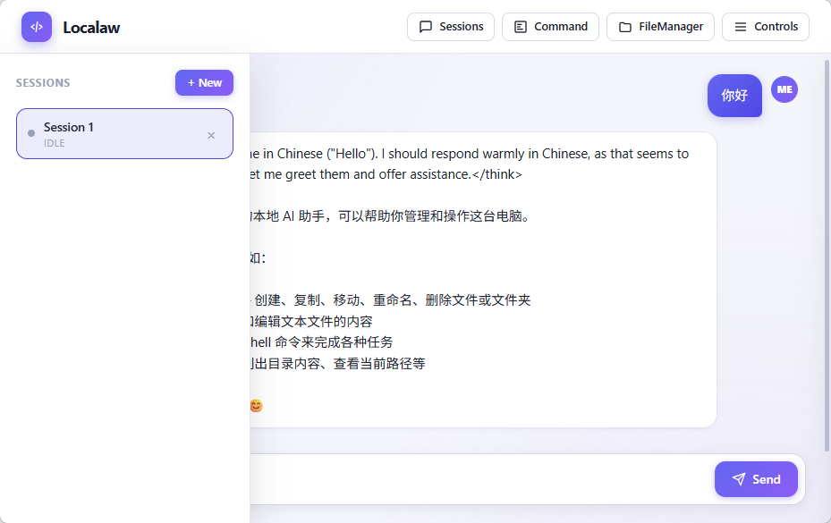
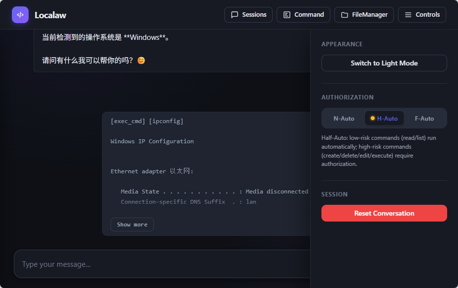

# Localaw

**中文** | [English](#english)

一个由 Go 编写的**纯本地 AI Agent**：连接 OpenAI 兼容的大模型 API（原生 Tool/Function Calling），
把模型的意图作为标准工具调用在**本机**执行，并把结果回灌模型续轮。

> 本项目是对原 Python 版 Localaw 的 Go 重构：指令调用从「提示词 → JSON 解析 → 执行」重写为
> **标准 Tool Calling** 流程；新增**多会话**；CLI 与 Web 交互参考 C2Agent 设计，界面基于原 Localaw 前端。


---

## 1. 特性

- **原生工具调用**：使用官方库 `github.com/openai/openai-go`，兼容任意 OpenAI 兼容端点（Ollama / vLLM / DeepSeek / OpenAI）。
- **MCP 支持（Client/Host）**：可连接 stdio、Streamable HTTP、旧版 HTTP+SSE 三类 MCP Server，自动发现并注册其 tools；
  工具名统一命名空间化，风险和授权沿用本地工具的三级策略。**仅支持 tools**，不支持 resources / prompts / sampling / elicitation。
- **多会话**：可同时存在多个彼此独立的会话（各自历史、轮数、授权、停止），会话在后台运行，页面刷新/断线不中断。
- **线性指令队列**：所有动作（LLM 工具调用与操作员直连命令）经**单条 FIFO 队列**串行执行；
  **排队等待不超时，执行中受 `cmd_timeout` 限制**（MCP 工具可按 Server/工具覆盖），超时终止**整个进程树**。
- **三级授权**：`0` N-Auto（全部需授权）、`1` H-Auto（低风险自动）、`2` F-Auto（全部自动）；
  授权通过会重置本轮轮数预算；拒绝则**不下发**该动作并结束本轮。
- **超时即失败**：执行超时终止进程树并将错误回灌模型（无断连语义，因为是本地执行）。
- **CLI + Web**：CLI 交互；Web 面板含会话列表、流式对话、授权弹窗、文件管理器、命令面板、授权模式滑块、深浅主题。
- **纯 Go、无 CGO**：可交叉编译 Windows / Linux / macOS 单文件二进制；前端以 `go:embed` 内嵌。

---

## 2. 架构

```
                    Localaw（Go 单进程）
  ┌──────────────────────────────────────────────────────────┐
  │   CLI              Web（net/http + SSE + go:embed 单页）   │
  │        └──────────────────┬───────────────────┘          │
  │                     Engine（多会话 / 授权 / 轮数 / 事件广播）│
  │                           │                              │
  │                 ToolRegistry（内置 14 工具 + MCP 工具）     │
  │                           │                              │
  │                    线性指令队列（单条 FIFO dispatcher）     │
  │                           │                              │
  │                    Executor（本机 / MCP 执行）             │
  │        ┌──────────────────┼──────────────────┐           │
  │   FileModule（文件操作） exec_cmd（Shell）   MCP Host      │
  └──────────────────────────────────────────────┼───────────┘
                           │                     │
                   本机文件系统 / Shell    stdio / HTTP / SSE
                                                 │
                                        外部 MCP Servers
```

**一次工具调用的数据流**：用户消息 → 该会话 goroutine → LLM（带内置 + MCP tools）→ 返回 `tool_calls`
→ 安全检查 → 授权判定 → 封装 Job 入队列（排队不超时）→ dispatcher 执行（本机命令或 MCP 调用，受工具/全局超时）
→ 结果写回本会话（`role=tool`）→ 回灌续轮（受 `round_limit`）。

---

## 3. 目录结构

```
LocalawX/
├── go.mod / go.sum
├── config.example.json
├── README.md / design.md
├── cmd/localaw/main.go            # 入口：--mode cli|web --config
├── internal/
│   ├── config/                    # 分层配置加载/校验/默认值
│   ├── command/                   # 内置动作表（名称/参数/风险/安全）
│   ├── toolreg/                   # 统一工具注册表（内置 + MCP）
│   ├── mcphost/                   # MCP Client/Host：stdio / HTTP / SSE、命名、转换
│   ├── procutil/                  # 跨平台进程树终止
│   ├── llm/                       # openai-go 客户端 + tools schema
│   ├── local/                     # 本机执行层：file / exec / 线性队列
│   │   ├── file.go
│   │   ├── executor.go
│   │   ├── queue.go
│   │   ├── proc_windows.go / proc_unix.go
│   ├── engine/                    # 多会话编排、授权、轮数、事件
│   │   ├── engine.go / session.go / events.go
│   ├── web/                       # net/http API + SSE + 内嵌前端
│   │   ├── server.go
│   │   └── ui/index.html
│   └── cli/cli.go                 # 交互式命令行
└── build/                         # 交叉编译脚本（build.bat / build.sh）
```

---

## 4. 环境要求

- Go **1.25+**（纯 Go，无需 CGO；MCP 官方 SDK 的最低要求）。
- 网络：能访问配置的 LLM API；连接远程 MCP Server 时还需能访问其地址。

## 5. 第三方依赖（Go）

| 模块 | 版本 | 说明 |
| ---- | ---- | ---- |
| `github.com/openai/openai-go` | v1.12.0 | OpenAI 兼容 API 客户端（流式 chat completions + tools） |
| `github.com/modelcontextprotocol/go-sdk` | v1.8.0 | 官方 MCP Go SDK（Client、stdio、Streamable HTTP、SSE） |
| 其余 | 间接 | 上游依赖（jsonschema-go、oauth2、x/sync 等） |

> 全部为纯 Go，不引入 CGO。官方 MCP SDK 要求 Go 1.25+。

---

## 6. 编译

```bash
# 本机
go build -o bin/localaw ./cmd/localaw

# 交叉编译（纯 Go，CGO_ENABLED=0）
build\build.bat        # Windows
./build/build.sh       # bash
```

产物在 `dist/`：

| 目标 | 产物 |
| ---- | ---- |
| win x86-64 | `dist/localaw_windows_amd64.exe` |
| win x86 (32) | `dist/localaw_windows_386.exe` |
| linux amd64 | `dist/localaw_linux_amd64` |
| linux x86 (32) | `dist/localaw_linux_386` |
| linux arm64 | `dist/localaw_linux_arm64` |
| darwin amd64 | `dist/localaw_darwin_amd64` |
| darwin arm64 | `dist/localaw_darwin_arm64` |

---

## 7. 运行

```bash
cp config.example.json config.json    # 填写 llm.api_base / api_key / model

# CLI（默认模式）
./bin/localaw --config config.json
# Web 面板：浏览器打开 http://127.0.0.1:8880
./bin/localaw --mode web --config config.json
```

### 配置（`config.json`）

> 配置采用严格解析：未知字段、尾随 JSON 都会导致启动失败，便于发现拼写错误。

| 分区 | 字段 | 说明 |
| ---- | ---- | ---- |
| `llm` | `api_base` / `api_key` / `model` / `temperature` / `stream` / `system_prompt` | LLM 接口；`system_prompt` 中 `{system_name}` 替换为本机 OS |
| `web` | `listen_host` / `listen_port` | Web 面板监听（默认 `127.0.0.1:8880`） |
| `policy` | `auth_mode` / `round_limit` / `cmd_timeout` / `max_sessions` / `queue_capacity` | 授权模式、轮数、执行超时、会话上限、队列容量 |
| `mcp` | 见下方「MCP 配置」 | 外部 MCP Server 列表与策略；缺省或 `enabled:false` 时完全不启用 |

### MCP 配置

Localaw 是 **MCP Client / Host**：它连接外部 MCP Server，把 Server 暴露的 **tools** 注册给 LLM。
它**不是** MCP Server，不会把自身的 14 个内置工具对外暴露。

> **能力范围：仅 tools。**
> Localaw 不实现 MCP 的 resources、prompts、sampling、elicitation、roots 能力；
> 客户端初始化时也不会宣告这些能力。Server 若依赖它们，相关调用会失败。
> Server 返回的 `instructions` 也不会自动注入系统提示词。
> 这样做是为了保持 Localaw 的攻击面最小：MCP Server 不能反向驱动 LLM 或弹出额外确认。

| MCP 能力 | 状态 | 说明 |
| -------- | ---- | ---- |
| tools | ✅ 支持 | 自动发现、注册、调用、刷新与授权 |
| resources | ❌ 不支持 | 不列出、不读取资源 |
| prompts | ❌ 不支持 | 不列出、不获取提示模板 |
| sampling | ❌ 不支持 | 不宣告该能力，Server 无法请求 Localaw 调用 LLM |
| elicitation | ❌ 不支持 | 不宣告该能力，Server 无法发起额外确认 |
| roots | ❌ 不支持 | 不宣告该能力 |
| logging / progress | ❌ 不消费 | Server 通知被忽略，仅保留基础连接日志 |

#### 1）完整示例

```json
{
  "mcp": {
    "enabled": true,
    "init_timeout": 15,
    "list_timeout": 10,
    "default_risk": "high",
    "default_timeout": 0,
    "max_tools": 128,
    "max_result_chars": 51200,
    "max_description_chars": 2000,
    "max_schema_bytes": 32768,
    "servers": [
      {
        "name": "filesystem",
        "transport": "stdio",
        "command": "npx",
        "args": ["-y", "@modelcontextprotocol/server-filesystem", "C:\\work"],
        "cwd": "",
        "env": { "SOME_TOKEN": "${SOME_TOKEN}" },
        "inherit_env": false,
        "enabled": true,
        "connect_timeout": 10,
        "call_timeout": 60,
        "default_risk": "high",
        "trust_annotations": false,
        "allow_tools": [],
        "deny_tools": ["delete_file"],
        "tools": {
          "read_file": { "risk": "low" },
          "write_file": { "risk": "high", "timeout": 30 }
        },
        "restart": {
          "enabled": true,
          "max_attempts": 10,
          "min_backoff": 1,
          "max_backoff": 60
        }
      },
      {
        "name": "remote",
        "transport": "http",
        "url": "https://example.com/mcp",
        "headers": { "Authorization": "Bearer ${MCP_TOKEN}" },
        "enabled": true,
        "connect_timeout": 10,
        "call_timeout": 120,
        "default_risk": "high"
      },
      {
        "name": "legacy",
        "transport": "sse",
        "url": "https://example.com/sse",
        "enabled": false
      }
    ]
  }
}
```

#### 2）全局字段（`mcp`）

| 字段 | 类型 | 默认 | 说明 |
| ---- | ---- | ---- | ---- |
| `enabled` | bool | `false` | MCP 总开关。为 `false` 时不连接任何 Server，行为与旧版本完全一致 |
| `init_timeout` | int（秒） | `15` | 启动时并行连接所有 Server 的总等待上限；超时不会阻止 Localaw 启动，未就绪的 Server 继续后台重连 |
| `list_timeout` | int（秒） | `10` | 每次 `tools/list`（含刷新）的超时 |
| `default_risk` | `low\|high` | `high` | MCP 工具的默认风险等级；`low` 才可能在 H-Auto 下自动执行 |
| `default_timeout` | int（秒） | `0` | MCP 工具调用默认超时；`0` 表示继承 `policy.cmd_timeout` |
| `max_tools` | int | `128` | 所有 MCP Server 合计暴露的工具上限；超出部分按 server/tool 名排序后截断并记录日志 |
| `max_result_chars` | int | `51200` | 单次 MCP 工具结果的最大字符数；超出截断并追加说明 |
| `max_description_chars` | int | `2000` | 单个 MCP 工具描述的最大字符数；超出截断为 `...` |
| `max_schema_bytes` | int | `32768` | 单个工具 `inputSchema` 的 JSON 大小上限；超限工具会被跳过 |
| `servers` | array | `[]` | Server 列表，见下 |

#### 3）Server 通用字段

| 字段 | 类型 | 默认 | 说明 |
| ---- | ---- | ---- | ---- |
| `name` | string | 必填 | Server 唯一名，`[A-Za-z0-9_-]{1,32}`；用于工具命名空间与状态展示 |
| `transport` | `stdio\|http\|sse` | 按字段推断 | `stdio` 本地子进程；`http` Streamable HTTP；`sse` 旧版 HTTP+SSE。省略时：有 `command` 推断为 stdio，有 `url` 推断为 http |
| `enabled` | bool | `true` | 是否连接该 Server；`false` 时该 Server 的工具不注册 |
| `connect_timeout` | int（秒） | `10` | 单次连接 + initialize 握手的超时 |
| `call_timeout` | int（秒） | `0` | 该 Server 工具调用的超时；`0` 继承 `mcp.default_timeout` / `policy.cmd_timeout` |
| `default_risk` | `low\|high` | 继承全局 | 该 Server 所有工具的默认风险；可被 `tools.<name>.risk` 覆盖 |
| `trust_annotations` | bool | `false` | 是否信任 MCP Server 提供的 `readOnlyHint` / `destructiveHint` / `openWorldHint` 注解来推断低风险。**默认关闭**，因为注解由 Server 自报，可能被伪造 |
| `allow_tools` | string[] | `[]` | 非空时作为白名单：只注册列表中的工具 |
| `deny_tools` | string[] | `[]` | 黑名单：不注册列表中的工具，优先级高于 `allow_tools` |
| `tools` | object | `{}` | 单工具覆盖策略，见下 |
| `restart` | object | 见下 | 断线/启动失败后的重连策略 |

> `allow_tools` / `deny_tools` / `tools` 的键使用 **MCP Server 返回的原始工具名**（例如 `read_file`），
> 不是 `mcp__server__read_file` 这种暴露名。

#### 4）stdio 专属字段

| 字段 | 类型 | 默认 | 说明 |
| ---- | ---- | ---- | ---- |
| `command` | string | 必填 | 启动命令，例如 `npx`、`uvx`、`python`、本地二进制路径 |
| `args` | string[] | `[]` | 命令参数 |
| `cwd` | string | 进程当前目录 | 子进程工作目录 |
| `env` | object | `{}` | 追加/覆盖的环境变量；值支持 `${VAR}` 展开 |
| `inherit_env` | bool | `false` | 是否继承 Localaw 完整进程环境。默认 `false`，只保留 PATH、HOME、TEMP、SystemRoot 等基础变量；设为 `true` 时第三方 Server 可读取 Localaw 的密钥等环境变量 |

Windows 提示：若 `command` 是 `.cmd` 包装器（如 `npx`）且启动异常，可显式写成
`"command": "cmd", "args": ["/c", "npx", "-y", "..."]`。正常关闭时先关 stdin；若 5 秒内未退出，
会终止整个进程树并关闭剩余管道。

#### 5）http / sse 专属字段

| 字段 | 类型 | 默认 | 说明 |
| ---- | ---- | ---- | ---- |
| `url` | string | 必填 | MCP 端点。`http` 建议使用 HTTPS；`sse` 为旧版 SSE 端点 |
| `headers` | object | `{}` | 每个请求附加的 HTTP 头，例如 `Authorization: Bearer ...`；值支持 `${VAR}` 展开。不会出现在日志或状态接口中 |

本期只支持**静态 Header/Bearer**，不实现 OAuth 授权流程。远程 Server 若要求 OAuth，请先在
网关侧转换，或等待后续版本。

#### 6）单工具策略（`tools`）

```json
"tools": {
  "read_file": { "risk": "low" },
  "write_file": { "risk": "high", "timeout": 30 }
}
```

| 字段 | 类型 | 说明 |
| ---- | ---- | ---- |
| `risk` | `low\|high` | 覆盖该工具的授权风险。`low` 在 `auth_mode=1`（H-Auto）下自动执行，`high` 仍需授权 |
| `timeout` | int（秒） | 覆盖该工具的执行超时；`0` 表示继承 Server/全局 |

#### 7）重连策略（`restart`）

| 字段 | 类型 | 默认 | 说明 |
| ---- | ---- | ---- | ---- |
| `enabled` | bool | `true` | 断线或首次连接失败后是否自动重连 |
| `max_attempts` | int | `10` | 最大尝试次数；达到后状态变为 `failed`，需重启 Localaw |
| `min_backoff` | int（秒） | `1` | 首次重试等待 |
| `max_backoff` | int（秒） | `60` | 指数退避上限（1→2→4→…） |

Server 连接成功后会重置尝试次数与退避。重连成功后会重新拉取工具列表。
`tools/list_changed` 通知也会触发工具刷新，无需重连。

#### 8）工具命名

所有 MCP 工具都会加上命名空间前缀，避免与内置工具或其他 Server 冲突：

```text
mcp__<server>__<tool>
```

示例：

```text
filesystem / read_file   -> mcp__filesystem__read_file
github / create.issue    -> mcp__github__create_issue
```

命名规则：

- 非 `[A-Za-z0-9_-]` 字符替换为 `_`，连续下划线折叠；
- 总长度不超过 64 字符（OpenAI 兼容端限制），超长时截断并追加 8 位哈希；
- 清洗后重名的工具追加哈希区分；
- 暴露名在同一工具集合内稳定且可预测；工具被移除后，模型若仍调用旧名，会收到普通的 “unknown action” 工具错误并继续本轮；
- **注意**：冲突集合发生变化时（例如两个冲突工具移除其中一个），存活工具的哈希后缀可能变化，暴露名也会随之改变。重启 Localaw 或重新读取工具列表后以最新 schema 为准。

#### 9）授权、风险与执行

- MCP 工具与内置工具共用**同一条线性队列**，因此 MCP 的文件/命令类工具不会与本地文件操作并发。
- 风险解析优先级：`tools.<name>.risk` → `server.default_risk` → `mcp.default_risk`（默认 `high`）。
- 授权模式：
  - `0` N-Auto：所有 MCP 工具都需授权；
  - `1` H-Auto：`low` 风险自动执行，`high` 风险需授权；
  - `2` F-Auto：全部自动执行。
- 默认**不信任** MCP 注解；只有显式设置 `trust_annotations: true`，且
  `readOnlyHint=true`、`destructiveHint=false`、`openWorldHint=false` 时，才可能推断为 `low`。
- 被拒绝的 MCP 工具**不会下发**，本轮直接结束；拒绝语义与本地工具一致。
- 执行超时沿用队列语义：超时 → 终止本轮并回灌错误；停止 → 取消调用并补齐剩余 tool 结果。
- MCP Server 返回 `isError:true` 时，作为普通工具结果回灌（前缀 `Error:`），本轮继续，模型可自行处理。

#### 10）结果转换

| MCP 返回内容 | 回灌给模型的文本 |
| ------------ | ---------------- |
| `TextContent` | 原文 |
| `ImageContent` / `AudioContent` | `[image: mime, N bytes]` / `[audio: ...]`（不把 base64 塞入上下文） |
| `ResourceLink` | `[resource: uri (name)]` |
| `EmbeddedResource`（文本） | 内嵌文本 |
| `EmbeddedResource`（二进制） | `[resource blob: uri, mime, N bytes]` |
| `StructuredContent` | 无文本时序列化为 JSON；有文本时追加 `[structured] ...` |
| 未知类型 | `[unsupported content: type]` |
| 空结果 | `(no output)` |

文本内容结果受 `max_result_chars` 限制；错误文本和结构化结果另有独立处理路径。

#### 11）状态与排错

- Web 面板：`Controls` 侧栏新增 **MCP Servers** 列表，显示 `ready / connecting / degraded / failed`、协议版本、工具数和最近错误**类别**。
- HTTP 接口：`GET /api/mcp/servers` 返回同样的状态（不含 `env` / `headers` 等敏感信息）；`error` 字段只返回
  `connection failed` / `handshake failed` / `tool list failed` / `tool call failed` 等类别，完整错误只写入本地日志。
- CLI：启动 banner 显示 MCP Server 数量、已就绪数量与工具数。
- 常见问题：
  - 状态 `failed`：查看终端日志中的连接错误；确认命令/URL、网络与认证头。
  - 工具数 0：Server 可能没有 tools，或被 `allow_tools` / `deny_tools` / schema 限制过滤。
  - 启动慢：`init_timeout` 内未就绪的 Server 会在后台继续连接，不影响 Localaw 使用。
  - 工具名冲突：检查日志中的跳过/哈希提示，必要时调整 `server.name`。

#### 12）安全说明

- MCP Server 是**操作员配置的受信任代码**；但其返回内容是**不可信数据**，可能包含提示注入。
- 默认风险为 `high`，`auth_mode=2` 时所有 MCP 工具都会自动执行，风险最高，请仅在受信环境使用。
- `headers` / `env` 可能包含密钥：不要提交到版本库；优先使用 `${VAR}` 从环境变量注入。
- 不要把密钥放在 URL 查询参数中；请使用 `headers`。
- `headers` 只会注入到 MCP 端点同源请求；跨域重定向会移除认证头，HTTPS → HTTP 降级会被拒绝。
- stdio Server 默认只继承 PATH/HOME/TEMP 等基础变量；只有显式设置 `inherit_env: true` 才会读取 Localaw 的完整环境变量（包括 LLM API Key 等）。
- 不宣告 sampling / elicitation / roots 能力，避免 MCP Server 反向调用 LLM 或操纵客户端。

---

## 8. CLI 命令

| 命令 | 说明 |
| ---- | ---- |
| `/sessions` | 列出会话 |
| `/new [title]` | 新建会话 |
| `/use <id\|index>` | 切换活动会话 |
| `/close <id>` | 关闭会话 |
| `/auth [0\|1\|2]` | 查看/切换授权模式（切换后即时重评估当前待授权动作） |
| `/reset` | 重置活动会话 |
| `/exec <command>` | 直接执行 shell 命令 |
| `/help` / `/quit` | 帮助 / 退出 |

授权提示下输入：`/y` 允许、`/n` 拒绝、`/auth 0|1|2` 切换模式后重新评估。

---

## 9. Web 面板

- 顶栏：Sessions（会话列表）、Command（直连命令）、FileManager（文件管理）、Controls（主题/授权/重置）。
- 左侧 Sessions 抽屉：新建 / 切换 / 关闭会话，运行中显示状态。
- 聊天区：SSE 流式输出、工具结果块、授权弹窗、停止；MCP 工具的授权弹窗会显示 `server / tool`。
- 文件管理器：真实绝对路径、进入目录、新建/删除/复制/移动、上传/下载（全部本机直连读写）。
- Controls 侧栏：MCP Server 状态列表（状态、协议、工具数、最近错误）。

主要接口：`/api/config`、`/api/mcp/servers`、`/api/sessions*`、`/api/history`、`/api/send`、`/api/chat-stream`(SSE)、
`/api/set-auth`、`/api/authorize-execute`、`/api/stop`、`/api/reset`、`/api/exec-cmd`、`/api/files/*`。

错误响应统一使用 4xx/5xx 状态码：参数校验错误为 400，资源不存在为 404；JSON 同时包含兼容字段
`error` 和规范字段 `err`。

### 界面截图

**主界面**——顶栏为 Sessions / Command / FileManager / Controls 四个入口，中央为流式对话区。


**多会话**——左侧 Sessions 抽屉可新建 / 切换 / 关闭会话，并显示会话状态（IDLE / running）。



**Controls**——切换深浅主题、授权模式（N-Auto / H-Auto / F-Auto）、重置当前会话。



**Command**——直接输入 shell 命令并在本机执行（操作员直连，不经授权约束）。


**FileManager**——真实绝对路径浏览，新建 / 复制 / 移动 / 删除、上传 / 下载。


---

## 10. 支持的工具

`get_cwd`、`list_dir`、`read_file`、`write_file`、`create_file`、`delete_file`、`delete_dir`、
`make_dir`、`rename_file`、`rename_dir`、`edit_file`、`copy`、`move`、`exec_cmd`。

- 低风险：`get_cwd`、`list_dir`、`read_file`；其余为高风险。
- 安全检查（仅 `exec_cmd`）：拦截 `rm` 命中根/`*`、`format c:`、`mkfs.`、`dd if=/dev/zero`。
- `edit_file` 采用**精确文本匹配**（`old_text`/`new_text`，可 `replace_all`）：`old_text` 必须唯一命中，否则拒绝写入并回灌错误，从根本上避免行号编辑导致的重复行/错位。
- MCP 工具不在上述静态表中，而是由 `internal/toolreg` 动态合并；名称统一为 `mcp__<server>__<tool>`，
  风险/超时/白黑名单由 `mcp` 配置解析。

---

## 11. 授权、轮数与队列

- **授权模式**：`0` N-Auto 全部需授权；`1` H-Auto 低风险自动、其余需授权；`2` F-Auto 全部自动。
- **轮数**：`round_limit` 限制单轮「LLM→动作→回灌」次数；**授权通过时清零**（拒绝不清零），任何模式都生效。
- **拒绝语义**：被拒动作**绝不下发**，作为 tool 结果回灌后**结束本轮**。
- **指令队列**：单条 FIFO；**排队等待无超时**，**执行受 Job/工具超时**（未指定时回退到 `cmd_timeout`），超时终止进程树并作为 tool 错误回灌。

---

## 12. 测试

```bash
go test ./...
go vet ./...
```

覆盖：工具表与授权/安全检查、文件操作、队列串行与超时终止、引擎工具调用与授权拒绝语义；
MCP 配置校验、工具命名/截断、Schema 与结果转换、风险解析、stdio/HTTP 连接、工具调用、
`tools/list_changed` 刷新，以及不配置 MCP 时的回归行为。

---

## 13. 安全与免责

- 本工具在**本机**执行模型生成的命令与文件操作；授权模式与安全检查可降低风险，但**非生产级防护**。
- MCP Server 由操作员配置并受信任，但其返回内容是**不可信数据**；默认风险为 `high`，不要默认信任 Server 注解。
- MCP 的 `headers` / `env` 可能包含密钥；优先使用 `${VAR}` 从环境变量注入，并限制配置文件权限。
- 为个人 / 受信环境使用；Web 面板默认仅监听 `127.0.0.1`。
- 操作员在 CLI/Web 的直连命令与文件操作不经授权约束（操作员即授权方）。
- **请勿在公开/生产环境部署。**

---

# English

A **purely local AI agent** written in Go: it talks to an OpenAI-compatible LLM
(native tool/function calling), runs the model's intents as standard tool calls on
**this machine**, and feeds results back to the model for the next round.

> A Go rewrite of the original Python Localaw: command invocation was moved from
> "prompt → JSON parsing → execute" to a **standard Tool Calling** flow; **multi-session**
> support was added; the CLI/Web interaction follows C2Agent, with the UI based on the
> original Localaw front-end.


## 1. Features

- **Native tool calling** via the official `github.com/openai/openai-go`; works with any OpenAI-compatible endpoint (Ollama / vLLM / DeepSeek / OpenAI).
- **MCP support (client/host)** — connects to stdio, Streamable HTTP and legacy HTTP+SSE MCP servers, discovers and registers their tools; tool names are namespaced and reuse the three-level authorization policy. **Tools only**: resources, prompts, sampling and elicitation are not supported.
- **Multi-session** — several independent sessions (own history, rounds, authorization, stop); sessions run in the background and survive page refreshes/disconnects.
- **Linear command queue** — every action (LLM tool calls and operator direct commands) runs serially on a **single FIFO queue**; **queue wait is unbounded, execution is bounded by the job/tool timeout** (falling back to `cmd_timeout`), which terminates the **whole process tree**.
- **Three-level authorization** — `0` N-Auto (all), `1` H-Auto (low-risk auto), `2` F-Auto (none); an approval resets the round budget; a denial **never dispatches** the action and ends the turn.
- **Timeout = failure** — a timeout kills the process tree and feeds the error back to the model (no disconnect semantics, since execution is local).
- **CLI + Web** — CLI interaction; a Web panel with session list, streaming chat, authorization popup, file manager, command panel, auth-mode slider and light/dark themes.
- **Pure Go, no CGO** — cross-compiles to Windows / Linux / macOS single binaries; the front-end is embedded via `go:embed`.

## 2. Architecture

```
                    Localaw (single Go process)
  ┌──────────────────────────────────────────────────────────┐
  │   CLI              Web (net/http + SSE + go:embed page)   │
  │        └──────────────────┬───────────────────┘          │
  │                     Engine (multi-session / auth / rounds │
  │                             / event broadcast)            │
  │                           │                              │
  │           ToolRegistry (14 built-ins + MCP tools)         │
  │                           │                              │
  │              Linear command queue (one FIFO dispatcher)   │
  │                           │                              │
  │                    Executor (local / MCP execution)       │
  │        ┌──────────────────┼──────────────────┐           │
  │   FileModule (file ops) exec_cmd (shell)     MCP Host     │
  └──────────────────────────────────────────────┼───────────┘
                           │                     │
                   local filesystem / shell  stdio / HTTP / SSE
                                                 │
                                        external MCP servers
```

**Data flow of one tool call**: user message → that session's goroutine → LLM (with built-in + MCP tools)
→ `tool_calls` → safety check → authorization decision → build a Job into the queue (wait
unbounded) → dispatcher executes (local command or MCP call, bounded by tool/global timeout) → result
written back to this session (`role=tool`) → fed back for the next round (bounded by `round_limit`).

## 3. Repository layout

```
LocalawX/
├── go.mod / go.sum
├── config.example.json
├── README.md / design.md
├── cmd/localaw/main.go            # entry: --mode cli|web --config
├── internal/
│   ├── config/                    # layered config load/validate/defaults
│   ├── command/                   # built-in action table (name/params/risk/safety)
│   ├── toolreg/                   # unified registry (built-ins + MCP)
│   ├── mcphost/                   # MCP client/host: stdio / HTTP / SSE, naming, conversion
│   ├── procutil/                  # cross-platform process-tree termination
│   ├── llm/                       # openai-go client + tools schema
│   ├── local/                     # local execution: file / exec / linear queue
│   │   ├── file.go
│   │   ├── executor.go
│   │   ├── queue.go
│   │   ├── proc_windows.go / proc_unix.go
│   ├── engine/                    # multi-session orchestration, auth, rounds, events
│   │   ├── engine.go / session.go / events.go
│   ├── web/                       # net/http API + SSE + embedded front-end
│   │   ├── server.go
│   │   └── ui/index.html
│   └── cli/cli.go                 # interactive CLI
└── build/                         # cross-compile scripts (build.bat / build.sh)
```

## 4. Requirements

- Go **1.25+** (pure Go, no CGO; required by the official MCP SDK).
- Network access to the configured LLM API; remote MCP servers additionally need network access to their URLs.

## 5. Third-party dependencies (Go)

| Module | Version | Notes |
| ------ | ------- | ----- |
| `github.com/openai/openai-go` | v1.12.0 | OpenAI-compatible client (streaming chat completions + tools) |
| `github.com/modelcontextprotocol/go-sdk` | v1.8.0 | Official MCP Go SDK (client, stdio, Streamable HTTP, SSE) |
| others | indirect | upstream deps (jsonschema-go, oauth2, x/sync, ...) |

> All are pure Go; no CGO. The official MCP SDK requires Go 1.25+.

## 6. Build

```bash
# Native
go build -o bin/localaw ./cmd/localaw

# Cross-compile (pure Go, CGO_ENABLED=0)
build\build.bat        # Windows
./build/build.sh       # bash
```

Outputs land in `dist/`:

| Target | Artifact |
| ------ | -------- |
| win x86-64 | `dist/localaw_windows_amd64.exe` |
| win x86 (32) | `dist/localaw_windows_386.exe` |
| linux amd64 | `dist/localaw_linux_amd64` |
| linux x86 (32) | `dist/localaw_linux_386` |
| linux arm64 | `dist/localaw_linux_arm64` |
| darwin amd64 | `dist/localaw_darwin_amd64` |
| darwin arm64 | `dist/localaw_darwin_arm64` |

## 7. Run

```bash
cp config.example.json config.json    # fill in llm.api_base / api_key / model

# CLI (default mode)
./bin/localaw --config config.json
# Web panel: open http://127.0.0.1:8880
./bin/localaw --mode web --config config.json
```

### Configuration (`config.json`)

> Configuration is parsed strictly: unknown fields and trailing JSON make startup fail, so typos surface early.

| Section | Fields | Notes |
| ------- | ------ | ----- |
| `llm` | `api_base` / `api_key` / `model` / `temperature` / `stream` / `system_prompt` | LLM endpoint; `{system_name}` in `system_prompt` is replaced with the local OS |
| `web` | `listen_host` / `listen_port` | Web panel listener (default `127.0.0.1:8880`) |
| `policy` | `auth_mode` / `round_limit` / `cmd_timeout` / `max_sessions` / `queue_capacity` | auth mode, rounds, execution timeout, session cap, queue depth |
| `mcp` | see “MCP configuration” below | external MCP servers and policy; omitted or `enabled:false` means off |

### MCP configuration

Localaw is an **MCP client/host**: it connects to external MCP servers and registers their **tools** for the LLM.
It is **not** an MCP server and does not expose its 14 built-in tools to other MCP clients.

> **Capability scope: tools only.**
> Resources, prompts, sampling, elicitation and roots are not implemented, and the client does not advertise
> those capabilities during initialization. Servers that depend on them will see their requests fail.
> The server’s `instructions` are not injected into the system prompt either.
> This keeps the attack surface small: an MCP server cannot drive the LLM or prompt the operator.

| MCP capability | Status | Notes |
| -------------- | ------ | ----- |
| tools | ✅ supported | discover, register, call, refresh, authorize |
| resources | ❌ not supported | not listed or read |
| prompts | ❌ not supported | not listed or fetched |
| sampling | ❌ not supported | not advertised; a server cannot ask Localaw to run the LLM |
| elicitation | ❌ not supported | not advertised; a server cannot prompt the operator |
| roots | ❌ not supported | not advertised |
| logging / progress | ❌ not consumed | server notifications are ignored; only basic connection logs remain |

#### Full example

```json
{
  "mcp": {
    "enabled": true,
    "init_timeout": 15,
    "list_timeout": 10,
    "default_risk": "high",
    "default_timeout": 0,
    "max_tools": 128,
    "max_result_chars": 51200,
    "max_description_chars": 2000,
    "max_schema_bytes": 32768,
    "servers": [
      {
        "name": "filesystem",
        "transport": "stdio",
        "command": "npx",
        "args": ["-y", "@modelcontextprotocol/server-filesystem", "C:\\work"],
        "env": { "SOME_TOKEN": "${SOME_TOKEN}" },
        "inherit_env": false,
        "connect_timeout": 10,
        "call_timeout": 60,
        "default_risk": "high",
        "trust_annotations": false,
        "deny_tools": ["delete_file"],
        "tools": {
          "read_file": { "risk": "low" },
          "write_file": { "risk": "high", "timeout": 30 }
        },
        "restart": { "enabled": true, "max_attempts": 10, "min_backoff": 1, "max_backoff": 60 }
      },
      {
        "name": "remote",
        "transport": "http",
        "url": "https://example.com/mcp",
        "headers": { "Authorization": "Bearer ${MCP_TOKEN}" },
        "call_timeout": 120,
        "default_risk": "high"
      },
      { "name": "legacy", "transport": "sse", "url": "https://example.com/sse", "enabled": false }
    ]
  }
}
```

#### Global options (`mcp`)

| Field | Type | Default | Meaning |
| ----- | ---- | ------- | ------- |
| `enabled` | bool | `false` | Master switch; false leaves Localaw’s behaviour unchanged |
| `init_timeout` | seconds | `15` | Total startup budget for parallel connections; failures do not block startup and are retried in the background |
| `list_timeout` | seconds | `10` | Timeout for each `tools/list` (including refreshes) |
| `default_risk` | `low\|high` | `high` | Default risk for MCP tools; only `low` can auto-run under H-Auto |
| `default_timeout` | seconds | `0` | Default call timeout; 0 inherits `policy.cmd_timeout` |
| `max_tools` | int | `128` | Cap across all MCP servers; extras are truncated by server/tool order and logged |
| `max_result_chars` | int | `51200` | Maximum characters per tool result; longer results are truncated with a marker |
| `max_description_chars` | int | `2000` | Maximum tool-description length; longer descriptions end with `...` |
| `max_schema_bytes` | int | `32768` | Maximum JSON size of one `inputSchema`; oversized tools are skipped |
| `servers` | array | `[]` | Server definitions |

#### Server options

| Field | Type | Default | Meaning |
| ----- | ---- | ------- | ------- |
| `name` | string | required | Unique name, `[A-Za-z0-9_-]{1,32}`; used as the tool namespace |
| `transport` | `stdio\|http\|sse` | inferred | stdio child process, Streamable HTTP, or legacy HTTP+SSE. If omitted: `command` → stdio, `url` → http |
| `enabled` | bool | `true` | Connect this server and expose its tools |
| `connect_timeout` | seconds | `10` | Timeout for connect + initialize |
| `call_timeout` | seconds | `0` | Per-server call timeout; 0 inherits global/policy |
| `default_risk` | `low\|high` | global | Per-server default risk, overridable per tool |
| `trust_annotations` | bool | `false` | Trust MCP `readOnlyHint` / `destructiveHint` / `openWorldHint` to infer low risk. Off by default because annotations are server-provided |
| `allow_tools` | string[] | `[]` | Non-empty allowlist |
| `deny_tools` | string[] | `[]` | Denylist; takes precedence over `allow_tools` |
| `tools` | object | `{}` | Per-tool overrides (`risk`, `timeout`) |
| `restart` | object | see below | Reconnect policy |

> Keys in `allow_tools` / `deny_tools` / `tools` are the **original MCP tool names** (e.g. `read_file`),
> not exported names such as `mcp__server__read_file`.

#### stdio-only options

| Field | Type | Default | Meaning |
| ----- | ---- | ------- | ------- |
| `command` | string | required | Launcher, e.g. `npx`, `uvx`, `python`, or a local binary |
| `args` | string[] | `[]` | Launcher arguments |
| `cwd` | string | process cwd | Child working directory |
| `env` | object | `{}` | Extra/overriding environment variables; values support `${VAR}` |
| `inherit_env` | bool | `false` | Inherit Localaw’s full environment. Default `false` keeps only PATH, HOME, TEMP, SystemRoot, etc.; `true` lets a third-party server read Localaw’s secrets |

On Windows, if a `.cmd` shim (e.g. `npx`) fails to launch, use
`"command": "cmd", "args": ["/c", "npx", "-y", "..."]`. Closing a stdio server closes stdin; if it does not
exit within 5 seconds, the whole process tree is terminated and remaining pipes are closed.

#### http / sse-only options

| Field | Type | Default | Meaning |
| ----- | ---- | ------- | ------- |
| `url` | string | required | MCP endpoint; prefer HTTPS for `http` |
| `headers` | object | `{}` | Static headers such as `Authorization: Bearer ...`; values support `${VAR}`. Never logged or returned by the status API |

Only static headers/Bearer are supported in this version; OAuth is not implemented.

#### Restart policy (`restart`)

| Field | Type | Default | Meaning |
| ----- | ---- | ------- | ------- |
| `enabled` | bool | `true` | Reconnect after a failed first connect or a dropped connection |
| `max_attempts` | int | `10` | Give up after this many attempts (`failed` state) |
| `min_backoff` | seconds | `1` | First retry delay |
| `max_backoff` | seconds | `60` | Exponential backoff ceiling (1→2→4→…) |

A successful connection resets attempts and backoff. `notifications/tools/list_changed` triggers a tool refresh
without reconnecting.

#### Tool naming

```text
mcp__<server>__<tool>
```

Examples: `mcp__filesystem__read_file`, `mcp__github__create_issue`.

- Characters outside `[A-Za-z0-9_-]` become `_`; runs of underscores collapse.
- The result is capped at 64 characters; long names are truncated with an 8-hex-digit suffix.
- Sanitized collisions get a hash suffix.
- If a tool disappears and the model still calls the old name, the turn receives an ordinary “unknown action” tool
  error and continues.
- **Note:** when the collision set changes (for example, one of two colliding tools is removed), the surviving
  tool’s hash suffix — and therefore its exposed name — may change. The latest schema is authoritative after a
  restart or tool-list refresh.

#### Authorization and execution

- MCP tools share the **same linear FIFO queue** as local actions, so MCP filesystem/command tools cannot race local
  file operations.
- Risk resolution: `tools.<name>.risk` → `server.default_risk` → `mcp.default_risk` (`high` by default).
- Auth modes: `0` all require approval; `1` low-risk auto-runs, high-risk requires approval; `2` all auto-run.
- Annotations are not trusted by default. With `trust_annotations: true`, a tool is inferred low-risk only when
  `readOnlyHint=true`, `destructiveHint=false` and `openWorldHint=false`.
- A denied tool is never dispatched and ends the turn, matching built-in tools.
- Timeouts and stop follow the queue semantics. MCP `isError:true` results are fed back as normal `Error: ...`
  tool results and the turn continues.

#### Result conversion

Text → text; images/audio → size placeholders (no base64 in context); resource links/embedded resources →
readable placeholders or text; structured content → JSON; unknown blocks → `[unsupported content: type]`;
empty → `(no output)`. Text content is capped by `max_result_chars`; error text and structured results have separate paths.

#### Status and troubleshooting

- Web: the Controls sidebar lists MCP servers with `ready / connecting / degraded / failed`, protocol, tool count and
  last error **category**.
- API: `GET /api/mcp/servers` returns the same status without `env`/`headers`; `error` is a category
  (`connection failed` / `handshake failed` / `tool list failed` / `tool call failed`), while full errors go to local logs.
- CLI: the banner shows server/ready/tool counts.
- `failed`: check terminal logs and the command/URL/auth headers. `0 tools`: the server has no tools or everything was
  filtered. Slow startup: servers not ready within `init_timeout` keep connecting in the background.

#### Security notes

- MCP servers are operator-configured, trusted code; their output is untrusted data and may contain prompt injection.
- Default risk is `high`; `auth_mode=2` auto-runs everything and has the highest risk.
- Secrets in `headers`/`env` should use `${VAR}`; stdio inherits only PATH/HOME/TEMP/etc. unless `inherit_env:true` is explicitly set.
- Do not put secrets in URL query strings; use `headers` instead.
- Configured headers are injected only for same-origin MCP requests; cross-origin redirects drop them, and HTTPS-to-HTTP downgrades are rejected.
- Sampling/elicitation/roots are not advertised, so servers cannot drive the LLM or the client.

## 8. CLI commands

| Command | Description |
| ------- | ----------- |
| `/sessions` | list sessions |
| `/new [title]` | create a session |
| `/use <id\|index>` | switch the active session |
| `/close <id>` | close a session |
| `/auth [0\|1\|2]` | show/set authorization mode (switching re-evaluates the pending action immediately) |
| `/reset` | reset the active session |
| `/exec <command>` | run a shell command directly |
| `/help` / `/quit` | help / exit |

At an authorization prompt: `/y` allow, `/n` deny, `/auth 0|1|2` switch mode and re-evaluate.

## 9. Web panel

- Top bar: Sessions (session list), Command (direct shell), FileManager (file operations), Controls (theme/auth/reset).
- Left Sessions drawer: create / switch / close sessions, with running state.
- Chat area: SSE streaming, tool-result blocks, authorization popup (shows `server / tool` for MCP), stop.
- File manager: real absolute path, navigate, create/delete/copy/move, upload/download (all local direct I/O).
- Controls sidebar: MCP server status list (state, protocol, tool count, last error).

Main endpoints: `/api/config`, `/api/mcp/servers`, `/api/sessions*`, `/api/history`, `/api/send`,
`/api/chat-stream` (SSE), `/api/set-auth`, `/api/authorize-execute`, `/api/stop`, `/api/reset`,
`/api/exec-cmd`, `/api/files/*`.

Error responses use 4xx/5xx statuses: 400 for parameter validation, 404 for missing resources. The JSON
contains both the legacy `error` field and the canonical `err` field.

### Screenshots

**Main** — top bar with Sessions / Command / FileManager / Controls; a streaming chat area in the center.


**Sessions** — the left Sessions drawer: create / switch / close sessions with their state (IDLE / running).


**Controls** — switch light/dark theme, authorization mode (N-Auto / H-Auto / F-Auto), and reset the active session.


**Command** — run a shell command directly on the local machine (operator direct, not authorization-gated).


**FileManager** — browse by real absolute path, create / copy / move / delete, upload / download.


## 10. Tools

`get_cwd`, `list_dir`, `read_file`, `write_file`, `create_file`, `delete_file`, `delete_dir`,
`make_dir`, `rename_file`, `rename_dir`, `edit_file`, `copy`, `move`, `exec_cmd`.

- Low risk: `get_cwd`, `list_dir`, `read_file`; the rest are high risk.
- Safety check (only for `exec_cmd`): blocks `rm` targeting root/`*`, `format c:`, `mkfs.`, `dd if=/dev/zero`.
- `edit_file` uses **exact-text matching** (`old_text`/`new_text`, optional `replace_all`): `old_text` must match uniquely or the write is rejected with an error fed back to the model, eliminating the duplicated/misplaced lines caused by line-number editing.
- MCP tools are not in the static table; `internal/toolreg` merges them dynamically under `mcp__<server>__<tool>`,
  with risk/timeout/allow-deny resolved from the `mcp` config.

## 11. Authorization, rounds and the queue

- **Auth modes**: `0` N-Auto (all need approval); `1` H-Auto (low-risk auto, rest need approval); `2` F-Auto (all auto).
- **Rounds**: `round_limit` caps the "LLM → action → feedback" loop per turn; an **approval resets** it (a denial does not), in every mode.
- **Denial semantics**: the denied action is **never dispatched**; it is fed back as a tool result and the **turn ends**.
- **Command queue**: a single FIFO; **queue wait is unbounded**, **execution is bounded by the job/tool timeout** (falling back to `cmd_timeout`), which kills the process tree and feeds the error back as a tool result.

## 12. Tests

```bash
go test ./...
go vet ./...
```

Covers: action table, authorization/safety checks, file operations, queue serialization and
timeout termination, engine tool-calling and denial semantics; MCP config validation, tool naming/truncation,
schema/result conversion, risk resolution, stdio and HTTP connections, tool calls, `tools/list_changed`
refresh, and regression behaviour when MCP is unconfigured.

## 13. Security & disclaimer

- The tool executes model-generated commands and file operations on **this machine**; auth modes and safety checks reduce risk but are **not production-grade protection**.
- MCP servers are operator-configured and trusted, but their output is **untrusted data**; the default risk is `high`, so do not trust server annotations by default.
- MCP `headers`/`env` may contain secrets; prefer `${VAR}` and restrict config-file permissions.
- For personal / trusted-environment use; the Web panel binds to `127.0.0.1` by default.
- Operator direct commands and file operations from the CLI/Web are not constrained by authorization (the operator is the authorizer).
- **Do not deploy in public/production environments.**
